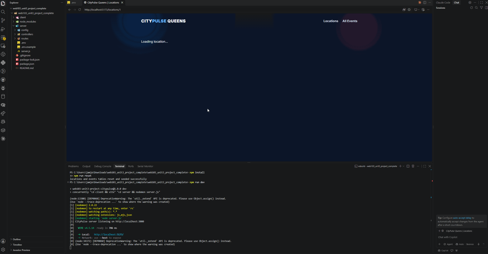

# WEB103 Unit 3 Project 3 - Virtual Community Space: CityPulse Queens

Submitted by: KDawTech

CityPulse Queens is a full-stack virtual community space that helps users discover events happening across four Queens neighborhoods. The React frontend loads location and event data from an Express API backed by PostgreSQL.

## Required Features

The following **required** functionality is completed:

- [x] The web app uses React to display data from an API
- [x] The web app is connected to a PostgreSQL database
- [x] The PostgreSQL database includes appropriately structured `locations` and `events` tables
- [x] The front page displays a title
- [x] The front page includes a visual interface with at least four selectable locations
- [x] Each location has its own detail page with a unique URL
- [x] Clicking a location navigates to its detail page
- [x] Each location page displays all events associated with that location

## Stretch Features

- [x] An additional Events page shows all events
- [x] Events can be filtered by location
- [x] Events display a live countdown/status indicating whether the event is upcoming or has passed

## Video Walkthrough

Add your walkthrough GIF as `demo.gif` before submitting:

## Setup

1. Run `npm install`
2. Copy `server/.env.example` to `server/.env`
3. Fill in your Render PostgreSQL values
4. Run `npm run reset`
5. Run `npm run dev`
6. Open the Vite URL shown in the terminal, normally `http://localhost:5173`

## API Routes

- `GET /api/locations`
- `GET /api/locations/:id`
- `GET /api/locations/:id/events`
- `GET /api/events`
